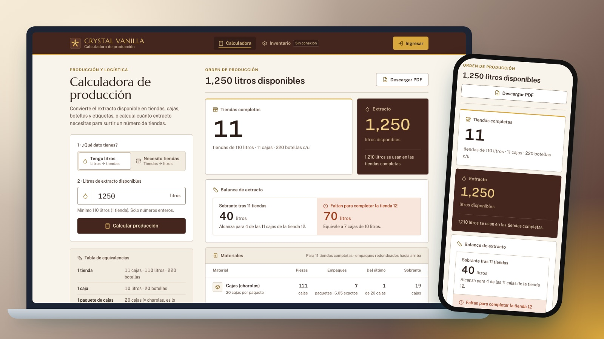
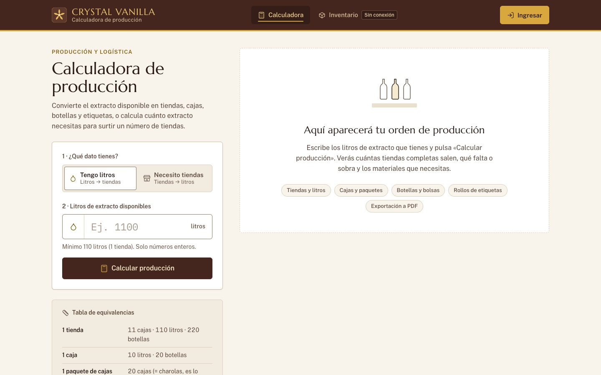
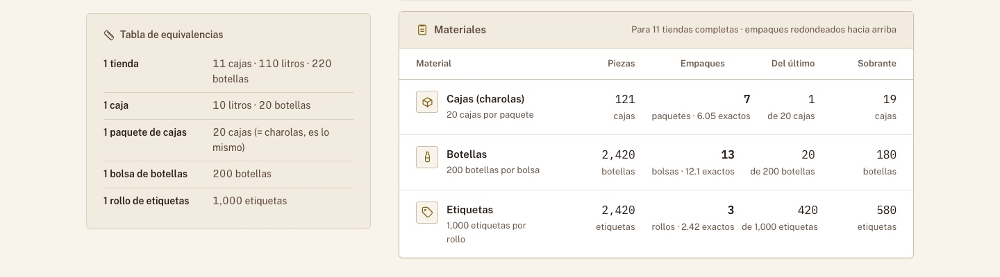
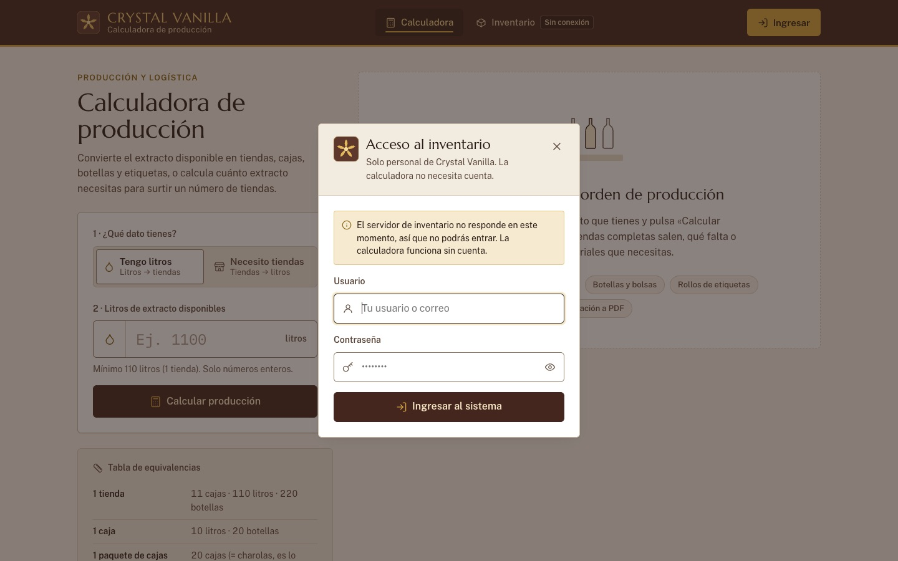
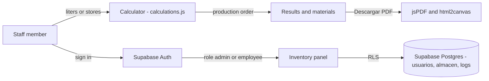

<div align="center">


# Crystal Vanilla

### Production calculator and inventory manager for a vanilla-extract business: from liters of extract to a full production order.

[](https://crystall-vanilla.vercel.app)

[](LICENSE)


<br/>



**[▶ Open the calculator](https://crystall-vanilla.vercel.app)** · **[User manual (ES)](MANUAL_USUARIO.md)** · **[Technical manual (ES)](MANUAL_TECNICO.md)**

</div>

> [!NOTE]
> **Status (Nov 2026):** the calculator works without an account. The inventory server (Supabase) is not responding, so the app shows **Inventario: Sin conexión** and the login warns that you can't sign in for now.

---

## 🎯 The problem

The business sells vanilla extract to stores in fixed runs: **1 store = 11 boxes = 110 liters = 220 bottles**. Every production decision meant doing the math by hand: how many full store runs the available extract covers, what is left over, how much is missing for the next run, and how many packs of boxes, bags of bottles and rolls of labels to order.

## 💡 The solution

Pick what you have (**liters of extract** or **number of stores to supply**), type a whole number and get a production order:

**Example with 1,250 liters (from the live app):**

| Result | Value |
|:--|:--|
| Full store runs | **11** (1,210 liters used) |
| Left over | 40 liters, enough for 4 of the 11 boxes of store 12 |
| Missing for store 12 | 70 liters (7 boxes of 10 liters) |
| Boxes (trays) | 121 boxes → 7 packs of 20 (19 left over) |
| Bottles | 2,420 → 13 bags of 200 (180 left over) |
| Labels | 2,420 → 3 rolls of 1,000 (580 left over) |

Every result can be downloaded as a **PDF report**.

## ✨ Features

<table>
<tr>
<td width="50%"><br/><b>Two modes:</b> liters → stores or stores → liters, with the equivalence table always visible and the client's real minimum batch (110 L) enforced.</td>
<td width="50%"><br/><b>Materials in one table:</b> pieces, packs rounded up (with the exact value), how many are used from the last pack and what is left over.</td>
</tr>
<tr>
<td width="50%"><br/><b>Inventory with roles:</b> staff sign in to track bottles, trays, caps and labels. <code>admin</code> edits stock, sees the activity log and manages users; <code>employee</code> gets read-only access.</td>
<td width="50%"><b>Also included</b><br/><br/>
• PDF export with jsPDF + html2canvas, loaded only when you press «Descargar PDF»<br/>
• Activity log of inventory changes, password changes and new users<br/>
• Row Level Security on every table (<code>usuarios</code>, <code>almacen</code>, <code>logs</code>)<br/>
• Responsive layout: on desktop the result appears next to the form, on mobile it scrolls to the result</td>
</tr>
</table>

## 🧠 How it works



The calculation logic lives in [`src/utils/calculations.js`](src/utils/calculations.js) and runs entirely in the browser; Supabase is only used for sign-in and inventory. The database is created with `database/reset_completo.sql` (see the [technical manual](MANUAL_TECNICO.md)).

## 🛠️ Stack

| Layer | Technology |
|:--|:--|
| Frontend | React 19 + Vite 8 · Framer Motion |
| PDF | jsPDF + html2canvas |
| Auth and data | Supabase (PostgreSQL + Auth + RLS) |
| Hosting | Vercel |

## 🚀 Run locally

```bash
npm install
cp .env.example .env   # add your Supabase URL and anon key
npm run dev
```

## 📂 Documentation

- [MANUAL_USUARIO.md](MANUAL_USUARIO.md): end-user guide (Spanish).
- [MANUAL_TECNICO.md](MANUAL_TECNICO.md): technical reference: structure, calculation logic, roles and database (Spanish).
- [docs/DESIGN_NOTES.md](docs/DESIGN_NOTES.md): Nov 2026 redesign notes (Spanish).

## 📄 License

[MIT](LICENSE)

---

<div align="center">

<sub>Built by <a href="https://github.com/ALFA117">ALFA117</a> as a freelance client project for Crystal Vanilla</sub>

</div>
